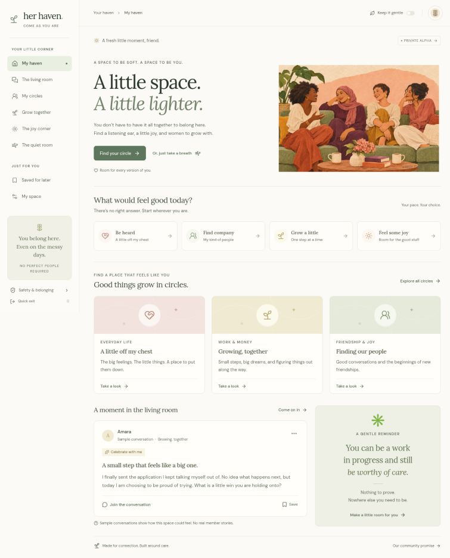

# Her Haven

A warm, responsive first build of a women-centered community: **come as you are, find your people, and grow at your own pace.**



## What this release does

Her Haven offers personal spaces and approved community circles:

| Space | Who can see the content | How access works |
| --- | --- | --- |
| **My haven** | Daily check-ins and one personal step are visible only in the signed-in account | Chosen-name profile and explicit adult/community agreement |
| **The living room** | The signed-in account only; fictional examples are labelled | Chosen-name profile and explicit adult/community agreement |
| **Community** | Approved members who have joined the same circle | Separate membership application, moderator approval, and explicit consent when sharing |

**Existing private posts, replies, bookmarks, and practice reports are never copied into the shared community.** A community membership is a server-side record tied to the existing trusted sign-in. This release continues to use ChatGPT sign-in on Sites and the loopback-only sign-in simulator for local development; it does not introduce a separate password system.

### Your daily haven

Members now arrive at a personal home screen with a daily check-in, a small next step, and a route to the kind of company or quiet they choose.

- Choose how today feels and what would help; add an optional private note. Saving is explicit. There is one editable check-in per local calendar day.
- Review earlier check-ins in pages of 14 and remove individual entries. This is personal reflection, not a health score or diagnosis. There are no streaks or pressure to log every day.
- Keep one small personal step for self care, connection, work and money, or joy. Edit it, mark it complete, undo completion, or remove it. Saving another step replaces the current one; a separate goal history is not maintained.
- Check-ins and the personal step are never added to community conversations or moderator snapshots. Community approval or suspension does not control access to this private space.
- Existing members can use the rest of Her Haven even if the daily area temporarily fails to connect. Draft notes remain in component memory while handling a failed save; they are not persisted in browser storage.

### Community features

- Membership application, pending decision, approval, decline, suspension, and moderator restoration.
- Shared discussions in the six existing circles, with stable pagination, per-page search, and support-style filters.
- Explicit audience acknowledgement before a post or reply is shared.
- “A quiet voice” posts: member-facing attribution is hidden, including replies from the original author on that thread. The service and moderators retain necessary account associations.
- Server-enforced no-replies preference, author deletion, and an owner-only contributions list that remains available during suspension or after private-profile reset.
- Bilateral blocking, including replies in another person's discussion.
- Confidential community reports with reporter-visible status and resolution notes.
- A **Care desk** for approved moderators: membership reviews, report review, content hide/restore, membership suspension/restoration, and audit history. Moderator roles are assigned outside the browser; no first-signup administrator shortcut exists.
- Bounded feed/reply pages, hourly action limits, and active-content limits. Moderation and owner-management lists show a bounded recent set.

### Private and wellbeing features

The cream-and-sage responsive interface, original illustration, private reflection space, saved items, circle choices, gentle mode, editable support scripts, joy prompts, and quiet-room timer remain available. Practice reports stay in their separate private queue. No direct messages, email/push notifications, AI conversations, or emergency response are implemented.

## Stack

- React and TypeScript, using the supplied Vinext application framework and its Next.js-compatible routing.
- Cloudflare Workers runtime.
- Cloudflare D1 with Drizzle schema and checked-in migrations.
- Sites-managed authentication for the hosted version.
- Lucide icons; original generated hero artwork served locally as an optimized WebP.

`app/components/Haven.tsx` owns the main experience. `app/components/Explore.tsx` provides resources, joy, quiet, and safety views. `lib/haven-data.ts` holds fictional examples and circle descriptions. `app/api/haven/route.ts` is the authenticated API. `lib/haven-validation.ts` validates requests. `db/schema.ts` declares the database schema. `/api/community` serves the shared circles; `/api/moments` serves only the authenticated account’s check-ins and personal step.

## Run locally on Windows

Use Node.js 22.13 or newer. The commands below also work with `npm` on macOS/Linux.

```powershell
npm.cmd ci
npm.cmd run build
npm.cmd run community:setup
npm.cmd run dev
```

Open the address printed by the server (normally `http://localhost:5173`). The portable profile supplies a loopback-only test sign-in at `/signin-with-chatgpt?return_to=/`. Finish **My space** to create the local profile.

`community:setup` applies the initial private schema only if it is absent, then applies the repeatable additive community and private-moments migrations. It preserves existing private records. It always uses Wrangler's **local** D1 database and `.wrangler/state`. It never changes the hosted database. Stop the development server before running setup commands.

### Upgrade an existing local checkout

Keep your local changes and database. From the repository directory:

```powershell
git pull --ff-only
npm.cmd run build
npm.cmd run community:setup
npm.cmd run dev
```

No dependency changes are required for this daily-haven release. If Git reports conflicting local work, resolve it before continuing; do not reset or clean the checkout to force the update.

### Try the moderator view locally

First complete the chosen-name profile through local sign-in. Stop the server with Ctrl+C, then run:

```powershell
npm.cmd run community:moderator -- --user local_seedy
npm.cmd run dev
```

Open **Community → Care desk**. `local_seedy` is the existing development simulator's account ID, not a production account. The helper requires an explicit account, checks its profile agreement, grants access only in this computer's local database, and records an audit entry. Repeating it for an already-approved moderator is harmless. `--remote` and alternative configuration arguments are rejected.

Local browser sign-in simulates one account; opening another browser does not create a second real member. The integration suite exercises multiple independent identities against the same actual SQLite database.

For ordinary member testing, open **Community** before granting moderator access, submit an introduction, and confirm that shared discussions stay locked while approval is pending. Use the moderator helper when you are ready to try publishing and the care desk.

### Local commands

| Command | Purpose |
| --- | --- |
| `npm.cmd run dev` | Local development, hot reload, and loopback test sign-in |
| `npm.cmd run build` | Compile the application and generate the Wrangler configuration |
| `npm.cmd start` | Run the built Worker locally; development sign-in is not supplied by this production build |
| `npm.cmd run community:setup` | Prepare/upgrade the local database without publishing anything |
| `npm.cmd run community:moderator -- --user local_seedy` | Explicitly enable the standard local test account as a moderator |

When running under the managed Sites environment, use its preview/build/publish workflow. Keep `scripts/`, `worker/`, the Sites Vite integration, and `.openai/hosting.json` intact.

## Checks

```powershell
npm.cmd test
npx.cmd tsc --noEmit
npm.cmd run build
```

The test suite includes the original private-input validation, community validation, the local setup helper's argument boundary, and integration scenarios that run the shipped community service against **real SQLite** through a D1-compatible adapter. It covers membership and circle gates, confidential reports, quiet attribution, ownership, bilateral blocking, suspension/reset persistence, additive migrations, pagination, rate caps, and authorization races. Private-moments tests additionally cover ownership, local-day handling, check-in history, one-goal replacement, deletion, profile reset, and concurrent limits. The test fixture does not replace application authentication in the running product.

See [validation details](docs/VALIDATION.md) for what was run and the limits of that evidence.

## Authentication and deployment

The current hosted private site uses the Sites authentication boundary. The API requires server-provided identity on every request and never accepts an identity from JSON request data. Private queries include the authenticated user key. Shared queries enforce approved membership, joined-circle access, content state, and blocks. Account IDs and email addresses are excluded from member-facing snapshots; moderators work with opaque community member IDs.

**Deploying this code outside Sites requires a replacement trusted authentication integration. Do not accept `oai-authenticated-user-*` headers directly from public clients.** A standalone host must verify sessions or tokens server-side and map them to the request identity.

The D1 binding name is `DB`. Deployment configuration is tracked in `.openai/hosting.json`. Runtime credentials and local databases are ignored by Git. Apply schema migrations before deploying the hosted Worker. The additive migrations are `drizzle/0001_community.sql` for Community and `drizzle/0002_private_moments.sql` for daily check-ins and the personal step. Existing hosted installations need both before their corresponding APIs can be used. An operator must explicitly grant the first production moderator through trusted database administration after verifying the intended sign-in identity; the local helper cannot do that. The source repository is public; the website audience remains private unless explicitly changed.

## Privacy and operating limits

- Eligibility starts with adult/women-community self-declaration and a separate membership approval. Neither step guarantees age, identity, gender, or intent.
- No real-world name, photograph, location, health history, or financial records are required.
- No notifications, email campaigns, third-party analytics, or AI conversations are implemented.
- Private practice content, daily check-ins, and the personal step are visible to their account; community content is shared with eligible circle members. Moderators can review relevant reports and hidden content. Hosting/database operators may have infrastructure access. No end-to-end encryption is claimed.
- The quick-exit link changes the screen. It does not clear browser history or defeat device monitoring.
- The community report queue is functional, but staff, coverage hours, escalation, and response commitments are operating responsibilities. Creating a dashboard does not staff it. The private practice queue is separate.
- Private reset deletes the profile, private practice data, daily check-ins, and the personal step. It intentionally retains community membership decisions and shared records so a reset cannot erase a suspension or moderation history. Authors can remove their shared contributions separately, including during suspension. Deletion clears ordinary member-facing content; existing confidential report evidence and audit records remain for review. Infrastructure backup retention is separate.
- Resource cards are conversation/reflection tools; they are not professional health or financial advice.
- Safety and privacy controls are never presented as guarantees against impersonation or screenshots.

## Next development stage

See [the roadmap](docs/ROADMAP.md) for operating the approved-member pilot. Authentication alone does not grant access to shared discussions. This source release does not change the existing hosted site audience or invite people.

## Artwork

The original illustration depicts fictional adult women sharing a relaxed moment. It was generated specifically for this project and optimized to `public/images/hero-gathering.webp`. It is decorative artwork, not a photograph or testimonial from members.
