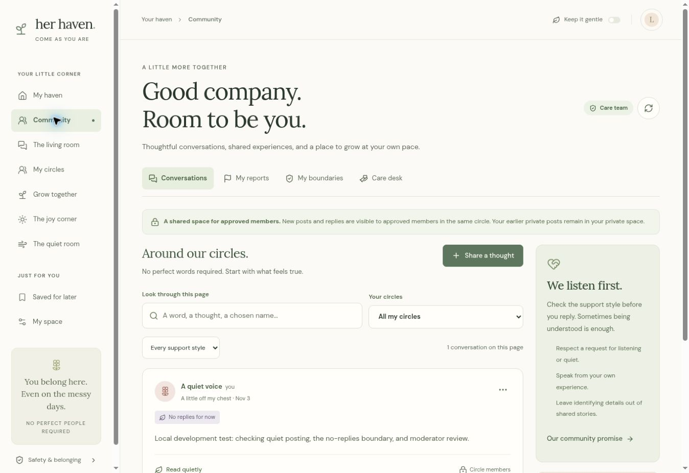
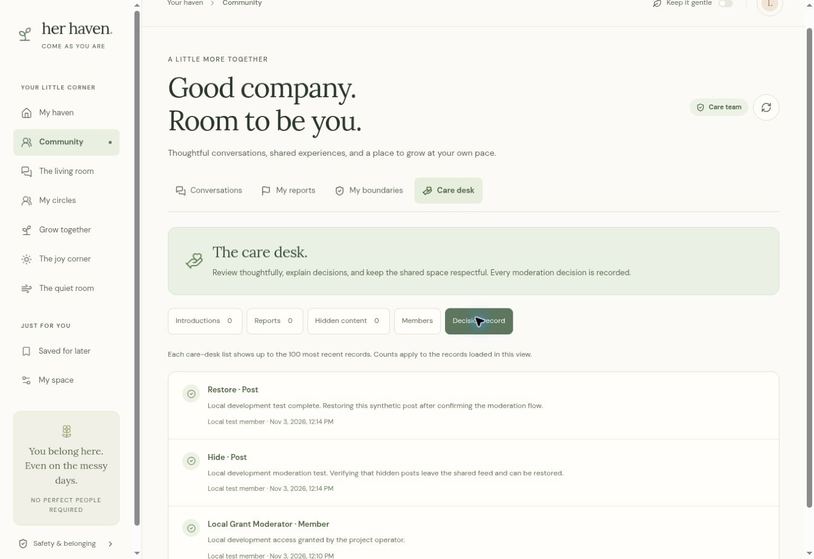

# Release verification

Community release verified on 3 November 2026 using synthetic local data; the Windows helper fix and daily-haven update were checked on 4 November 2026. These source updates have not been deployed to the earlier hosted private alpha.

## Daily haven — 4 November 2026

- `npm test`: **58 passed, 0 failed, 0 skipped**. The 19 new moments tests comprise 7 validation checks and 12 service integration scenarios using real SQLite.
- `tsc --noEmit`: passed. The production build passed with `/`, `/api/haven`, `/api/community`, and the new `/api/moments` route.
- Targeted ESLint for the new component returned no errors and one `no-img-element` advisory for the existing decorative WebP. This is not a claim that the entire repository is lint-clean.
- The new scenarios cover account isolation (including moderator accounts), exclusion from shared Community snapshots, independent private access during community suspension, daily upserts, local-calendar boundaries, history pagination, owner deletion, current-goal replacement/completion/undo, stale IDs, private reset cascades, concurrent capacity limits of 365 entries, and six profile-change/write races.
- `community:setup` successfully applied the additive private-moments migration to the existing synthetic local database. Its subprocess regression still verifies the file-URL preload fix and now checks that the additional migration is invoked.
- Generated Drizzle metadata was checked against the shipped SQL for columns, equivalent default values, primary keys, foreign keys, and indexes. No historical private or shared content is copied into the new tables.
- The earlier Windows helper fix and Care desk hide/restore flow were also confirmed by the owner on their Windows setup. That user confirmation is separate from these Linux automated checks.

### Daily browser checks

The managed preview used the existing local sign-in simulator and synthetic moderator account; no hosted data was used.

1. Saved a mood, selected need, and optional private note. Edited and saved that same day, then confirmed the history contained one updated entry.
2. Saved a personal step, completed it, and reloaded the page. Both the updated note and completed step persisted. Reopening the step with **Keep working on it** restored the active state.
3. Followed the selected need's **Visit the quiet room** link and verified the quiet-room screen.
4. Checked saved summaries and editable check-in forms in 320px and 390px same-origin iframe viewports. Corrected the saved-status spacing that caused a small horizontal overflow; document width then matched the available viewport width at both sizes. Visually checked the mood choices, need choices, note, and save controls. These are responsive layout checks, not physical-device tests.

## Windows local-command fix — 4 November 2026

The local helper previously passed a native absolute path to Node's `--import`. A Windows drive letter was therefore treated as a URL scheme, producing `ERR_UNSUPPORTED_ESM_URL_SCHEME` before Wrangler could execute. The preload is now resolved as a file URL relative to `import.meta.url`. Filesystem arguments, the local-only database flag, and `shell: false` are unchanged.

- Added a subprocess regression that runs both `setup` and `moderator` from a temporary project path containing spaces, `#`, and `%`. It loads the actual environment module and uses a fake Wrangler CLI to inspect the spawned arguments without accessing a database or network.
- Confirmed this regression fails before the fix and passes afterward. It also checks that every database invocation retains `--local` and receives a `file:` preload URL pointing to the correct file.
- `npm test`: **39 passed, 0 failed, 0 skipped** after the fix.
- The real `community:setup` and `community:moderator -- --user local_seedy` commands completed against the existing synthetic local database on Linux. The existing moderator grant was preserved.
- A native Windows runtime was not available here. The regression is platform-independent and will exercise drive-letter paths when run on Windows. The earlier production build remains applicable because this patch changes only the development helper, its tests, and this document.

## Community release

- `npm test`: **38 passed, 0 failed, 0 skipped**. This comprises 11 private-input/HTTP-boundary checks, 7 community validation checks, 18 community SQL integration scenarios, and 2 local helper checks.
- `tsc --noEmit`: passed after the final component changes.
- `npm run build`: passed, producing `/`, `/api/haven`, and `/api/community`.
- Targeted ESLint passed for `CommunityView.tsx`; this is not a claim that the entire pre-existing repository is lint-clean.
- `git diff --check`: passed.

The community integration fixture executes the shipped service against Node's real SQLite engine through a D1-compatible adapter. It covers approval and joined-circle boundaries, consent, ownership, quiet attribution including author replies, no-replies enforcement, report confidentiality and evidence retention, hide/restore, bilateral blocking, suspension across private-profile reset, owner deletion while restricted, pagination ties, concurrent quotas/caps, and authorization changes between context reads and writes. It does not substitute an authentication bypass into the running application.

The additive migration was applied repeatedly without changing historical private data. Generated Drizzle metadata was compared with the shipped SQL for tables, columns, foreign keys, and indexes. The local setup helper was exercised against a profile created in the browser, and the local-only moderator grant produced the expected audit entry.

### Browser checks

The managed development preview was tested through the browser using the normal local sign-in simulator and one synthetic account:

1. Completed the chosen-name profile and membership application. The pending account displayed **Awaiting review** and no shared feed.
2. Granted that account local moderator access with the explicit helper, restarted the preview, and verified the approved community and care desk.
3. Created a quiet-voice shared post with **No replies for now**. Sharing remained disabled until the audience acknowledgement was checked. The thread displayed no reply form.
4. Hid the post with a reason, confirmed its removal from conversations, restored it through **Hidden content**, and confirmed both reasons in **Decision record**.
5. Reloaded the page and confirmed membership and the restored post persisted.
6. Inspected the community feed and sharing dialog in 390px and 320px same-origin iframe viewports. Document and dialog content widths showed no horizontal overflow. Also checked the care desk at 320px. These are responsive layout checks, not physical-device tests.
7. Fixed and rechecked native-dialog centering on desktop. Long moderator/report-card names and status chips wrap at narrow widths.

## Evidence limits

- The browser development simulator supplies one account. Multiple identities, approval/decline/suspension, report privacy, and cross-account attacks were checked in the SQLite integration suite, not in a multi-person browser session.
- The managed preview is reachable from the browser but not from the executor's loopback network. The existing two-account HTTP test in `tests/backend-integration.mjs` was not run successfully in this environment. It remains a separate verification step where the process and preview share a local origin. No network or authentication bypass was added.
- SQLite service tests do not establish hosted Cloudflare behavior. Hosted sign-in, migrations, moderator provisioning, and independent member sessions still need a deployment smoke test before a member pilot. This update changes neither the hosted site audience nor its database.
- A functional report queue does not establish staffing, response time, membership-verification quality, or emergency coverage.

## Earlier private-alpha checks

The first release separately passed its 11 validation checks, TypeScript check, and production build. Browser review covered the home page, navigation, conversation response filtering, reading a sample conversation, support-script editing/copying, joy activities, and quiet-timer start/pause. Its phone layouts were checked at 390px and 320px. Those checks are retained here as prior evidence; this community pass did not repeat every unrelated private-alpha interaction.
